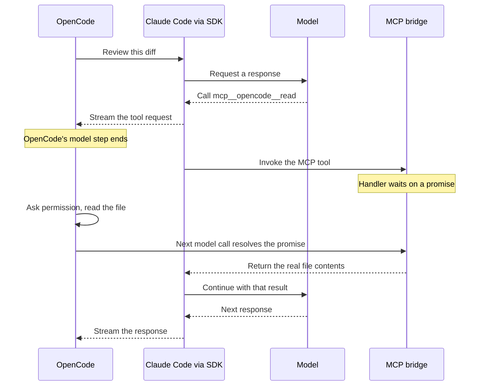
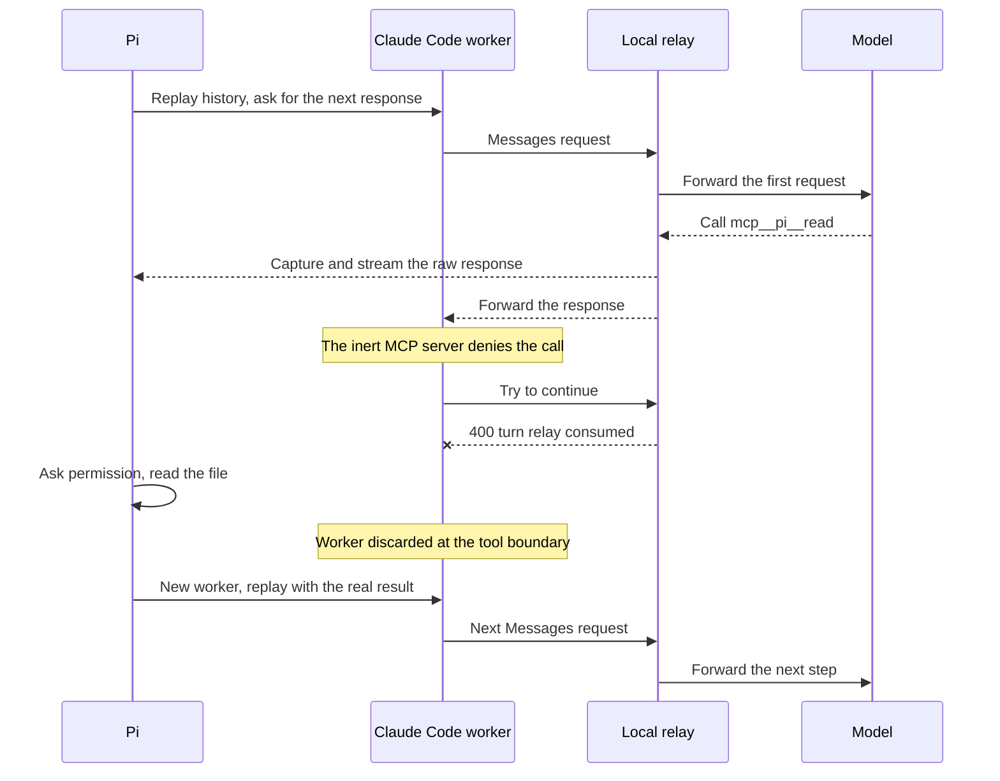
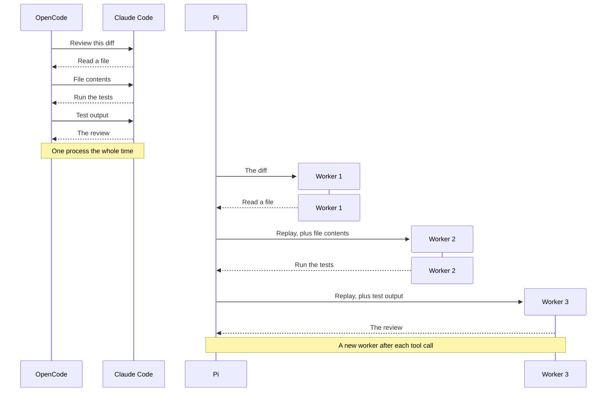
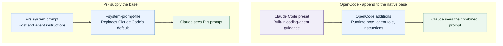
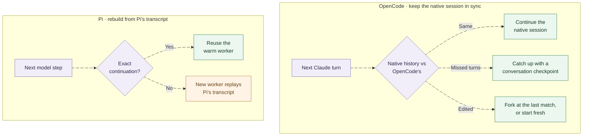

OpenCode now has a Claude Agent provider that uses an existing Claude Code login. Pi has a similar option through the [pi-claude-code](https://github.com/earendil-works/pi-claude-code) extension. Both let me use the Claude subscription I already pay for while keeping the tools and interface of another coding agent.

I read the source of both integrations as of writing this post (pinned revisions are linked at the end) to see what each one does between its host, OpenCode or Pi, and Claude Code. The login part is straightforward. Where the two integrations split is what happens after the model asks to run a tool.

OpenCode keeps a Claude Code session running and pauses it while OpenCode runs the tool. Pi asks Claude Code for one model response, takes the tool request out, and rebuilds the conversation for the next step. That choice shapes who owns the transcript, what the system prompt looks like, how prompt caching survives, and how much of Claude Code's internals each integration has to understand.

# What both integrations do the same way

The harness is the program around the model. It builds the context, runs tools, asks for approval, and decides what happens next. Both integrations keep that work in the outer harness:

- The installed `claude` program handles model access using whatever login it already has. Neither integration copies Claude Code's credentials.
- Claude Code's built-in tools are disabled. The outer harness runs every tool and owns the approval flow.
- Claude Code's own compaction is disabled. The outer harness compacts the conversation.
- The user's Claude Code settings files and MCP servers are skipped.

Disabling Claude Code's built-in tools keeps tool execution in one place. If OpenCode shows me an approval dialog while Claude Code can still run its own shell tool behind it, there are two execution paths to reason about. Turning off the built-in tools avoids that.

Both integrations also expose the host's tools to Claude Code over MCP, the Model Context Protocol, under names like `mcp__opencode__read` or `mcp__pi__read`. They diverge when Claude Code calls one of those tools.

# Two paths to the model

The arrows below show the path a model request takes. Responses come back the same way.

```mermaid
flowchart TB
  subgraph OpenCodePath["OpenCode · a native SDK session"]
    O["OpenCode<br/>Context, permissions, tools"] o1@--> S["Claude Agent SDK<br/>Public query API"]
    S o2@--> C["Installed Claude Code<br/>Existing login"]
    C o3@--> A["Anthropic API"]
  end
  subgraph PiPath["Pi · one model response per step"]
    P["Pi<br/>Context, permissions, tools"] p1@--> J["Installed Claude Code<br/>CLI stream-json protocol"]
    J p2@--> R["Local turn relay<br/>Gate, capture, rewrite"]
    R p3@--> B["Anthropic API"]
  end
  o1@{ animate: true }
  o2@{ animate: true }
  o3@{ animate: true }
  p1@{ animate: true }
  p2@{ animate: true }
  p3@{ animate: true }

  classDef host fill:#eaf3ff,stroke:#3978b5,color:#172b40;
  classDef bridge fill:#f1eef9,stroke:#8470ac,color:#302347;
  classDef upstream fill:#ebf7ef,stroke:#43845c,color:#173723;
  classDef relay fill:#fff3e6,stroke:#b77d38,color:#644015;
  class O,P host;
  class S,C,J bridge;
  class A,B upstream;
  class R relay;
```



OpenCode uses Anthropic's public Claude Agent SDK. The SDK is a programmatic wrapper around the Claude Code CLI: it starts a `claude` process and talks to it for you. OpenCode gives it the path to the installed `claude` (from `OPENCODE_CLAUDE_PATH` or `PATH`), so it runs with the existing login. Claude Code sends the API requests itself, with nothing between it and the backend.

Pi skips the wrapper. It starts `claude -p` itself and speaks the CLI's `stream-json` protocol directly. It also sets `ANTHROPIC_BASE_URL` on each Claude Code worker to a random route on a loopback-only HTTP relay run by the extension. When Claude Code sends a request, it hits Pi's local relay, which forwards the request upstream and reads the response before passing it back to Claude Code.

Because of that relay, Pi sees the authenticated headers on every request even though it never reads the credentials file on disk. The extension's [architecture document](https://github.com/earendil-works/pi-claude-code/blob/70abb65186592ca788b29b3db22c3160d629c41f/ARCHITECTURE.md) calls this out directly. Both integrations still require a local Claude Code install and route every call through it, so neither turns a subscription into a general-purpose API key.

# Following one tool call

For the rest of the post, I will trace one example where I ask the agent to review a diff and the model starts by reading one of the changed files.

## OpenCode waits inside the tool handler

OpenCode passes an in-process MCP server to the Claude Agent SDK. When the model calls `mcp__opencode__read`, Claude Code invokes that server's handler. Instead of reading the file itself, the handler waits on a promise until OpenCode runs the tool and hands back the result.

OpenCode already sees the tool call in the SDK's message stream, so why the MCP server? The stream only goes one way. OpenCode can watch it, but it cannot push a tool result back into Claude Code's running turn. Claude Code will not continue until a tool it knows about returns, and with its built-in tools off, the MCP server is the only place its tools come from. So the MCP server does two jobs. It tells Claude Code which tools exist, and it gives Claude Code something to call and wait on while OpenCode does the real work.

Watch the highlighted step move through the exchange. Hover over the diagram to pause it and see every step.



From OpenCode's side, this looks like any other model. The step ends at the tool call, OpenCode's normal agent loop runs the tool, and its next model call carries the result. That call resolves the promise, and the MCP handler returns the file contents to Claude Code. Both OpenCode's history and the native Claude Code session record the same real tool result, and the Claude Code process stays alive for the next model response and the next tool call.

The [implementation](https://github.com/anomalyco/opencode/blob/bf5d12c588911a35ec56ad991c3b83cf937f424a/packages/core/src/plugin/provider/claude-agent/tools/pending.ts) is a map of pending promises, resolved when OpenCode's own tool execution finishes. A few hooks and settings around the MCP server handle the details:

- **Matching calls to IDs.** The MCP handler does not receive Claude's tool-call ID, so a `PreToolUse` hook captures it right before the handler runs. Because the bridge stores that ID in a single slot, it marks every tool as not read-only so Claude Code runs tool calls one at a time.
- **Rich results.** A `PostToolUse` hook swaps in results that the plain MCP path cannot return in the shape Claude Code expects, such as PDFs and images.
- **Long waits.** OpenCode removes Claude Code's MCP tool timeout from the environment so permission prompts and slow subagents do not fail while waiting.

OpenCode keeps one Claude Code process per chat session, because the SDK runs one process per conversation and cannot share it between sessions. After five minutes idle it stops the process, and the next message resumes the saved native session. Time spent waiting on a permission prompt or a running tool does not count as idle: stopping the process then would record the tool call as cancelled by the user. The system prompt, tools, connection settings, and output limit are fixed when the process starts, so changing any of them starts a new one.

## Pi intercepts the tool request

Pi handles the same read differently. Like OpenCode, it gives Claude Code an MCP server so the model knows which tools exist. The difference is what happens when Claude Code calls one. OpenCode's handler waits for the real result. Pi's handler answers straight away with a fixed denial:

```text
Denied: Claude Code tools are inert; only Pi executes tools.
```

Pi does not want Claude Code to get a result at all. It starts Claude Code with built-in tools off, `--max-turns 1`, and `--no-session-persistence`, because all it wants is one model response, including any tool requests in it. Pi then runs the tool in its own agent loop. Its MCP server is only there so the model can see the tools.

This is where it gets awkward, because Claude Code is an agent, not a plain API client. After the denial, it may try to recover by asking the model again, even with `--max-turns 1` and retries set to zero. That second request would cost quota and produce a reply Pi throws away. Claude Code may also end the turn with a max-turns error or a recovery message of its own, which gets in the way of the original response Pi needs.

So Pi puts the local relay from the earlier diagram between Claude Code and Anthropic. It lets the first model request through, keeps a copy of the raw response as it comes back, and refuses any request after that.



The relay forwards one upstream Messages request per Pi step. Any further request from that worker gets a `400` with the message `PI_CLAUDE_CODE_TURN_RELAY_CONSUMED` before it can reach Anthropic.

Because the relay sits on the HTTP stream, it captures the first raw response before Claude Code processes it. By the time Claude Code turns the denied tool call into a max-turns error or a synthetic recovery message, Pi has already recorded the original tool arguments, stop reason, signed thinking blocks, and token usage. The extension converts those into Pi's message format, and Pi runs the real tool.

Once the inert MCP server returns the denial, Claude Code records that denial as the tool result in its own history. Because the worker's transcript no longer matches Pi's transcript, the extension discards the worker and replays Pi's updated history into a new worker on the next step.

## One request across two tool calls

Now consider a request that needs two tool calls before the final review (reading a file and running the tests):



OpenCode stays in the same Claude Code process across the whole request. Pi starts a fresh worker for each model step after a tool call, and each new worker begins by replaying the conversation so far.

Pi only reuses a warm worker when the next request is an exact continuation with no tool call in between, such as a plain follow-up question. It keeps at most two warm workers, expiring each one five minutes after it was created. OpenCode instead expires its process after five minutes of idle time and can resume the saved native session later.

# Keeping the prompt prefix stable

When Claude Code sends a turn, it injects extra context around the user's messages: environment details, reminders, skill lists, and nested `CLAUDE.md` files. If those blocks move around or repeat on every fresh worker, a conversation that looks identical in Pi becomes a different prompt upstream. Because prompt caching matches on the exact prefix, any shift in those injected blocks causes a cache miss and burns quota on a long conversation.

OpenCode avoids this by telling Claude Code to skip the extra context. It sets the SDK's `verbatimPrompts` option, which sends each message as given without injecting per-turn context (OpenCode has already expanded `/commands` and `@file` references itself). OpenCode's [design spec](https://github.com/anomalyco/opencode/blob/bf5d12c588911a35ec56ad991c3b83cf937f424a/specs/v2/claude-agent-provider.md) notes that this is why it requires Claude Code 2.1.248 or later, since older versions ignore the option and can treat user text as Claude Code commands.

Pi lets Claude Code add the context and then rewrites its placement in the relay:

- It records the native user prefix and system reminders from the first request, puts them back in the same place on every replay, and removes the reminders that move.
- It moves cache breakpoints so each tool round does not invalidate the cached prefix.
- It puts tools that were added or removed mid-conversation back at the point where they changed, using the matching beta header on models that support it.
- It cancels the upstream socket as well as the child process when Pi cancels.

Pi also normalizes tool schemas for Claude Code along the way, which may simplify nullable types and compositions such as `oneOf`, `allOf`, and `anyOf`.

Rewriting requests in the relay gives Pi control over every model call, at the cost of depending on the exact request shape Claude Code produces. If a Claude Code update changes that shape, the relay can break. I would expect OpenCode's warm session to skip some process start-up and replay work, but Pi's relay is built specifically to keep the prompt cache warm across workers. Comparing speed or quota use between the two would need measured runs.

# System prompts

For ordinary chats, OpenCode uses the SDK's `claude_code` preset (Claude Code's own system prompt) and appends its own instructions. Pi writes a system-prompt file from its own transcript and passes it with `--system-prompt-file`, replacing Claude Code's default.



`--system-prompt-file` only replaces the base prompt; Claude Code still adds the per-turn context from the previous section, and Pi's relay manages it.

Here are the two choices, trimmed from the source:

```ts
// OpenCode: keep Claude Code's prompt, append host instructions.
const primary = {
  type: "preset",
  preset: "claude_code",
  snapshot: false,
  append:
    "<runtime_info>You are running in OpenCode through the Claude Code harness. Mention this only when asked.</runtime_info>",
};
```

```text
# Pi: replace the default prompt with a generated file.
claude -p ... --system-prompt-file <pi-generated-system.md> ...
```

After the preset, OpenCode appends the selected agent's role, `AGENTS.md` content, skills, MCP instructions, and other host context, while leaving out OpenCode's usual built-in system prompt. Even though it keeps Claude Code's base prompt, OpenCode starts Claude Code with no settings sources, disables `CLAUDE.md` loading and auto-memory, and skips the user's Claude Code skills, MCP servers, and hooks in favor of OpenCode's own equivalents (its two in-code bridge hooks still run).

This matters most for an agent whose job is not general coding, such as a review agent told to report findings and not modify files. In OpenCode, that role is appended after Claude Code's prompt, which is written for an agent that edits code. In Pi, it sits inside a prompt that Pi and the application wrote. I have not tested whether that changes how closely the model sticks to the role. Either way, "do not modify files" is only an instruction. To enforce it, the harness has to withhold write tools or deny writes, which both OpenCode and Pi can do because they run the tools.

# Why doesn't OpenCode replace the prompt?

The Claude Agent SDK supports custom system prompts, and OpenCode's provider already replaces the prompt for standalone utility calls such as generating a session title. Only chats and conversation branches use the `claude_code` preset.

For conversation branches, such as compaction or side tasks, a comment in the source explains that OpenCode forks the native Claude session with the same tools and system prompt so Claude can reuse the chat's prompt cache. Neither the source comments nor the [design spec](https://github.com/anomalyco/opencode/blob/bf5d12c588911a35ec56ad991c3b83cf937f424a/specs/v2/claude-agent-provider.md) explains why the main chat uses the preset in the first place.

On the implementation PR, someone asked about Anthropic's terms, and the maintainer who wrote it [replied](https://github.com/anomalyco/opencode/pull/58782#issuecomment-6527771235):

> We got permission from Anthropic and everything here is fully tos compliant

That comment does not say whether keeping the native system prompt was part of that approval, or how Anthropic treats an integration like Pi's that rewrites requests through a local relay. Each prompt choice fits the rest of its integration. OpenCode keeps a native Claude Code conversation and moves tool execution out to the host, so keeping the native prompt matches that setup. Pi uses Claude Code as a single-turn model call inside its own transcript and agent loop, where Pi already builds the system prompt.

# Switching models and branching history

Keeping a native Claude Code session alive means OpenCode has two histories to keep in sync whenever I switch models or edit an earlier turn.

OpenCode's own database stays the source of truth. If another model wrote the last ten messages, Claude's native session has never seen them. When I switch back to Claude, OpenCode sends the missed history inside a user message wrapped in a `<conversation-checkpoint>` block (with thinking text omitted), instructs Claude to treat that block as earlier conversation, and places the new user input after it. If the Claude session already saw earlier turns, OpenCode sends only what that session missed.

After an edit or undo, OpenCode looks for the last point where its history and the native history still match (as long as that boundary does not fall between a tool call and its result) and forks the native session from there. If there is no usable match, OpenCode starts a fresh native session and sends the whole history as catch-up.

Pi does not maintain a long-lived native session. Its structured transcript is always the input, and each worker is built from it, preserving compatible native blocks and replay metadata where available. It does not promise a byte-for-byte rebuild of every history from every provider. When it cannot reproduce a mid-conversation tool change exactly, it falls back to the current tool list and may lose the cache.



As in my [Pi `/tree` post](/blog/2026/02/26/pi-tree-context-window-management), branching a conversation in either harness changes the history sent to the model on the next turn; none of these forks roll back files or create a Git worktree.

# Credentials, overage, and billing

OpenCode's Claude Agent provider works with a subscription, an API key, or a cloud provider account, depending on how Claude Code is logged in. It can also pass a custom base URL, key, and headers through to Claude Code. With a subscription it reports zero API cost, though plan quota limits still apply.

Pi's provider is built for subscription logins. It refuses to start if the environment sets an API key, an auth token, a base URL, or a Bedrock, Vertex, or Foundry override, so a session cannot quietly bill a metered account.

Pi also checks Claude Code's `rate_limit_event` on every turn. If the event sets `isUsingOverage`, the turn drew from paid usage credits instead of the plan's included quota, and the extension fails the turn with a non-retryable billing error unless `PI_CLAUDE_CODE_ALLOW_USAGE_CREDITS` is set. Because the event arrives with the response, that first overage turn has already been charged; the guard only stops the agent loop from spending more on subsequent turns.

Pi's [billing code](https://github.com/earendil-works/pi-claude-code/blob/70abb65186592ca788b29b3db22c3160d629c41f/src/billing.ts) also matches upstream errors containing *"third-party apps now draw from your extra usage"* and turns them into the same non-retryable billing error. A comment in that file notes that Anthropic returns this message when it classifies a request as third-party app usage rather than standalone Claude Code. The extension's README also notes that in May 2026 Anthropic announced, and then put on hold, a move of `claude -p`, Agent SDK, and third-party usage to a separate credit billed at API rates.

# Side by side

<div style={{overflowX: "auto"}}>

| | OpenCode Claude Agent | Pi's `pi-claude-code` |
| --- | --- | --- |
| Talks to Claude Code through | Public Agent SDK | CLI `stream-json`, plus a local relay |
| Upstream requests | Sent by Claude Code, untouched | Gated, captured, and sometimes rewritten by the relay |
| Who runs tools | OpenCode, through an MCP handler that waits | Pi, after an inert MCP server denies the call |
| After a tool result | Same Claude Code session continues | New worker replays Pi's history |
| Process lifetime | One per chat, five minutes idle, resumable | One per model step after a tool call; at most two warm, five minutes each |
| Chat system prompt | Claude Code preset plus OpenCode additions | Pi's prompt replaces Claude Code's |
| History from other models | Catch-up content in a user message | Rebuilt from Pi's structured transcript |
| Edit or branch | Native fork at the last matching point | Rebuild from the selected history |
| Claude Code's per-turn context | Turned off with `verbatimPrompts` | Kept, and repositioned by the relay |
| Keeping the cache warm | Native continuity; branches keep the chat prompt | Reminder placement, cache breakpoints, tool-change replay |
| Logins accepted | Subscription, API key, cloud provider, custom gateway | Subscription only; conflicting overrides rejected |
| Main cost | Lives with Claude Code's prompt and history model | Owns replay and request-compatibility machinery |

</div>

For interactive coding, I would start with OpenCode's waiting bridge. The native conversation receives the real tool results directly, without spawning a new worker and replaying history after every tool call. I would still test how it handles serialized tool calls, cancellation, model switches, and long approval waits.

For an application that needs the same controlled system prompt and transcript format across every model provider, Pi's approach fits better. Every model step is built from the host's own records, at the cost of maintaining the replay and request-compatibility code as Claude Code changes.

# Wrapping up

In my [last post](/blog/2026/10/26/durable-code-mode-in-pi), I looked at how an agent harness recovers a running tool script after the process crashes. Looking at OpenCode and Pi side by side shows how much harness design matters even within a single live turn.

Both integrations use the same local Claude login and both keep tool execution in the host harness. From there, OpenCode keeps the conversation inside a running Claude Code session and waits for the host to finish each tool call, while Pi keeps the conversation in its own transcript and calls Claude Code one response at a time. Even with the same model and login, the harness around the model changes what prompt it sees and how its conversation history is built.

# Sources and version scope

Source links are pinned so the comparison can be checked after either project changes.

- **OpenCode:** [`bf5d12c`](https://github.com/anomalyco/opencode/tree/bf5d12c588911a35ec56ad991c3b83cf937f424a), October 30, 2026. The [provider design spec](https://github.com/anomalyco/opencode/blob/bf5d12c588911a35ec56ad991c3b83cf937f424a/specs/v2/claude-agent-provider.md), [SDK query options](https://github.com/anomalyco/opencode/blob/bf5d12c588911a35ec56ad991c3b83cf937f424a/packages/core/src/plugin/provider/claude-agent/claude/query-options.ts), [MCP tool server](https://github.com/anomalyco/opencode/blob/bf5d12c588911a35ec56ad991c3b83cf937f424a/packages/core/src/plugin/provider/claude-agent/tools/server.ts), [pending tool calls](https://github.com/anomalyco/opencode/blob/bf5d12c588911a35ec56ad991c3b83cf937f424a/packages/core/src/plugin/provider/claude-agent/tools/pending.ts), [system-prompt construction](https://github.com/anomalyco/opencode/blob/bf5d12c588911a35ec56ad991c3b83cf937f424a/packages/core/src/plugin/provider/claude-agent/language-model/system-prompt.ts), [request routing](https://github.com/anomalyco/opencode/blob/bf5d12c588911a35ec56ad991c3b83cf937f424a/packages/core/src/plugin/provider/claude-agent/language-model/claude-agent-language-model.ts), [session lifetime](https://github.com/anomalyco/opencode/blob/bf5d12c588911a35ec56ad991c3b83cf937f424a/packages/core/src/plugin/provider/claude-agent/claude/sessions.ts), and [history catch-up](https://github.com/anomalyco/opencode/blob/bf5d12c588911a35ec56ad991c3b83cf937f424a/packages/core/src/plugin/provider/claude-agent/sync/catch-up.ts).
- **Pi extension:** [`70abb65`](https://github.com/earendil-works/pi-claude-code/tree/70abb65186592ca788b29b3db22c3160d629c41f), October 12, 2026. The [architecture](https://github.com/earendil-works/pi-claude-code/blob/70abb65186592ca788b29b3db22c3160d629c41f/ARCHITECTURE.md), [CLI workers and replay](https://github.com/earendil-works/pi-claude-code/blob/70abb65186592ca788b29b3db22c3160d629c41f/src/claude-cli.ts), [turn relay](https://github.com/earendil-works/pi-claude-code/blob/70abb65186592ca788b29b3db22c3160d629c41f/src/turn-relay.ts), [inert MCP server](https://github.com/earendil-works/pi-claude-code/blob/70abb65186592ca788b29b3db22c3160d629c41f/src/inert-mcp.mjs), and [billing guard](https://github.com/earendil-works/pi-claude-code/blob/70abb65186592ca788b29b3db22c3160d629c41f/src/billing.ts).
- **Setup and limitations:** [OpenCode V2 providers](https://opencode.ai/v2/docs/providers#claude-agent) and the [Pi extension README](https://github.com/earendil-works/pi-claude-code/blob/70abb65186592ca788b29b3db22c3160d629c41f/README.md). OpenCode requires Claude Code 2.1.248 or later in the version reviewed here.
- **Permission statement:** [Claude Agent provider PR #58782](https://github.com/anomalyco/opencode/pull/58782), specifically the [maintainer's October 30 reply](https://github.com/anomalyco/opencode/pull/58782#issuecomment-6527771235).

This post is based on reading the source at the revisions above rather than benchmarking latency or quota use, and provider or billing behavior can change independently of these pinned sources.
