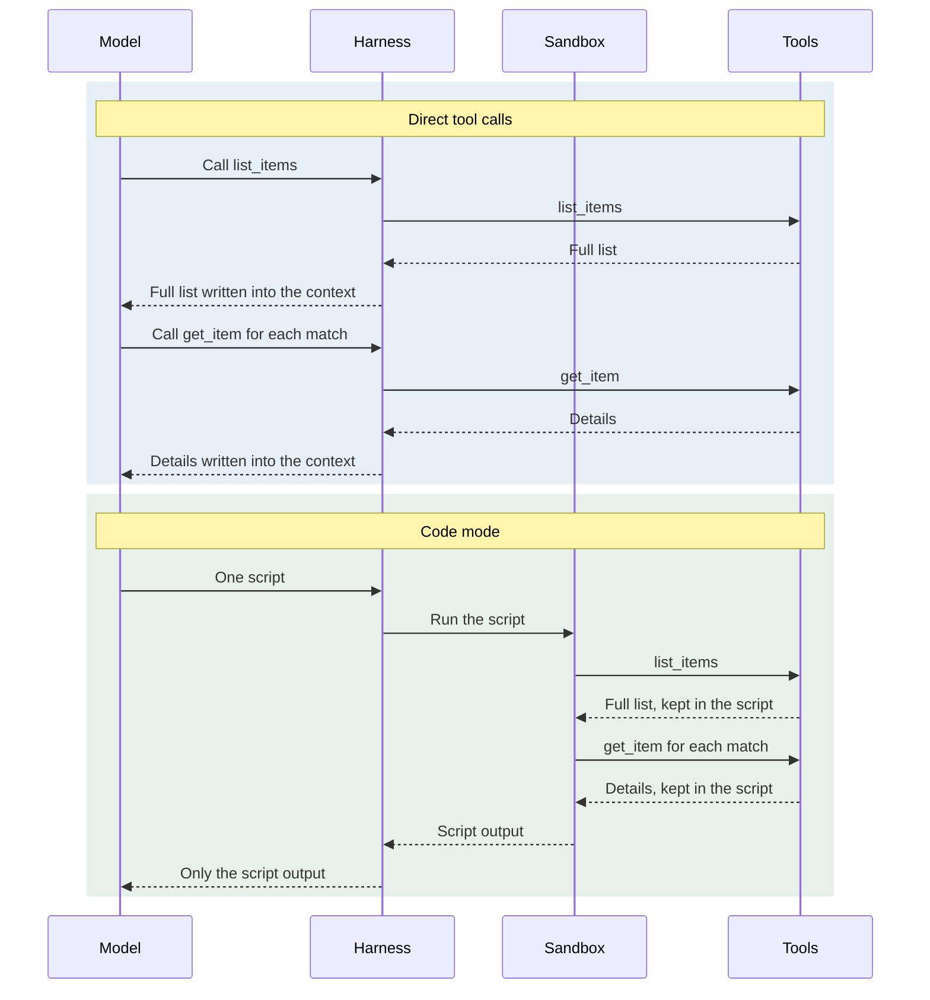
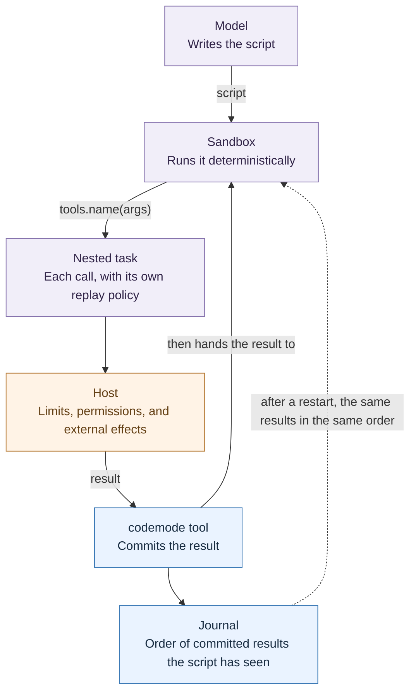
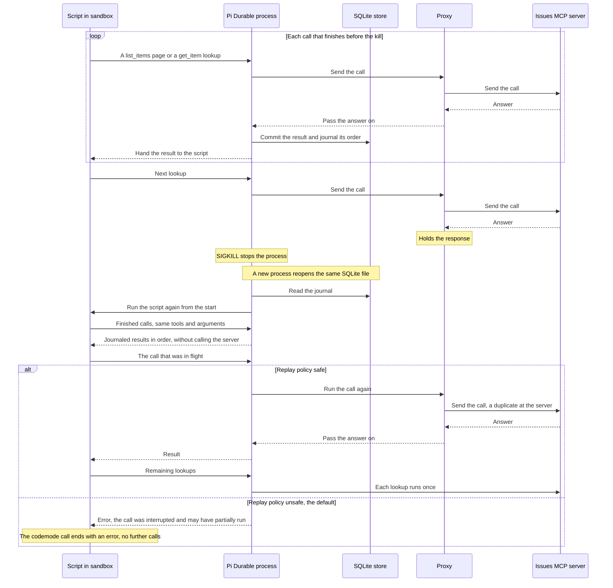

Most agent harnesses run tools the same way. The model asks for one or more calls, the harness runs them, and every result is written into the context before the model takes its next turn. Parallel calls shorten that loop when the calls are independent. They do not help when the next call depends on what the last one returned.

> **Note:** Pi does not write very large tool results into the context whole. Large outputs from `bash` and from MCP tools (tools served by an external process over the Model Context Protocol) are trimmed, and the full text goes to a temp file the model can read. The model still pays for whatever it reads back.

Code mode changes that. The model writes one script that calls the tools, and only the script's output comes back. The intermediate data stays in the script. In the small experiment later in this post, that was the main benefit: in the Pi coding agent, much less tool output reached the model.

Here is a list lookup that feeds a detail lookup, run with direct calls and then in code mode:



But what happens to that script when the process dies halfway through? In Pi Durable, it resumes, and the tool calls that already finished do not run again.

In my [previous post](/blog/2026/10/05/pi-durable), I looked at how Pi Durable treats the commit as the unit that matters: the transcript, tasks, and documents are saved together or not at all, so what you see is what was saved. Code mode puts that idea to the test, because a script is work in flight that the commit has to cover too. This post covers what code mode is and what it costs, how three harnesses implement it, a small experiment, how Pi Durable replays a script after a crash, a crash test of that replay, and when I would use it.

# What code mode is

Code mode is a way of running tools in which the model writes a script and the host runs it in a sandbox. The script calls tools as functions, and only its output goes back to the model.

The argument for it is that models are better at writing code against an API than at making tool calls one at a time. Several agent harnesses ship code mode, including Pi and OpenCode.

# Why use it

**Less context.** The script can filter, join, or count intermediate data in code. That data stays in the script, and the model only sees the answer.

**Chaining without round trips.** Models can already make parallel tool calls, so parallelism is not the win. The win is chaining: one call's result feeds the next without a trip back to the model.

**Smaller tool definitions.** With many MCP servers connected, the tool definitions alone can take tens of thousands of tokens before the model reads the request. Code mode can load only the definitions it needs, by browsing them as files or searching for them. That saving depends on how many tools you have. My experiment had only two MCP tools, and in both harnesses the code mode tool made the first prompt larger, not smaller.

> **Note:** Both Pi and OpenCode turn code mode on only once MCP tools are connected. With just the built-in tools, code mode adds its own description to the prompt and has few tool definitions to save.

# What it costs

**Sandboxing.** You are now running model-written code. The host has to decide what that code can reach, and running a sandbox is operational overhead that direct tool calls avoid. The implementations below make very different choices here.

**Approval per call.** A host that asks a person before a sensitive tool call now has to pause in the middle of a script, because one script can call many tools. A script that waits on a person is also a script that has to survive while it waits.

**Half-done work.** With direct calls, the model can recover from a bad result on the next step. A script cannot do that. It runs to the end on whatever the model assumed when it wrote the script, and if that assumption is wrong, it fails partway. For example, the model may test a script on a few items, see it work, and then run it on the full list, where the server caps how many items it returns. By then some calls have finished and some have not, and the harness has to decide what happens to the rest.

**Restarts.** A script is in-flight work. If the process dies mid-script, something has to decide what happens next. The rest of this post is about that question.

# Three implementations

Pi appears twice below. The Pi coding agent is a command-line harness with code mode built in. Pi Durable is a library for building agent apps whose state survives a restart, and it adds code mode through an extension. OpenCode is a separate command-line harness. All three ship code mode now. They differ in the runtime, in how tools appear to the script, and in what happens on a restart.

<div style={{overflowX: "auto"}}>

| | Pi coding agent | Pi Durable | OpenCode |
| --- | --- | --- | --- |
| How to get it | Built-in `codemode` tool since 0.99.0; on automatically when an MCP server connects, or set `"defaultTools": ["+codemode"]` | `@earendil-works/pi-durable/codemode` extension | `execute` tool, on by default for MCP tools |
| Runtime | JavaScript in QuickJS | JavaScript in QuickJS (`@earendil-works/pi-codemode`), or a remote sandbox on Cloudflare | Its own interpreter for a JavaScript-like language |
| Tools in scripts | `tools.<name>(args)`; TypeScript signatures up to a size limit, the rest found with `searchTools()` | Same as Pi, plus `describeTool()` for one tool's signature and `describeNamespace()` for a group of tools | `tools.<server>.<tool>(...)`, grouped by MCP server; signatures up to a size limit, the rest found with `search(...)` |
| MCP tools | Connects to MCP servers itself; a server set to `codemode` exposure is reached only through scripts | No MCP client of its own; MCP tools are passed in like any other tool, and a `namespaces` option groups them by name prefix, for example `mcp__github__` | Code mode is the default for MCP tools; `codemode: false` gives a server's tools to the model directly |
| After a restart | Script is lost; the model starts it again and every call runs again | Script resumes without rerunning finished calls | Script is lost; the model starts it again and every call runs again |
| Status | New | Experimental | Shipping |

</div>

OpenCode does not sandbox arbitrary JavaScript at all. Its [codemode package](https://github.com/anomalyco/opencode/blob/dev/packages/codemode/README.md) runs only the language features it implements and returns an `UnsupportedSyntax` diagnostic for the rest. Scripts have no filesystem, processes, imports, or timers. They reach the outside world only through tools the host program provides. The codemode package does not include `fetch` for HTTP requests, but OpenCode adds it, so scripts in OpenCode can call web URLs directly. If a script fails or ends while some of its tool calls are still running, OpenCode stops those calls, and the work is left half done.

Pi takes the other route and runs real JavaScript in QuickJS, a small JavaScript engine that runs inside the host process. Because the host runs the engine, Pi Durable can control what the script sees, such as the clock and random numbers. Replay, described below, depends on that.

Neither the Pi coding agent nor OpenCode documents what happens to a running script after a crash, so I killed each one partway through a script and asked it to continue. Both marked the interrupted call as failed, and the model started the script again from the beginning. Every lookup ran a second time, including the ones whose results had already come back.

# Trying it on one task

To see this outside the docs, I ran one small task in OpenCode v2.1.4 and the Pi coding agent 1.4.0 (`@earendil-works/pi-coding-agent`), both on `gpt-6.1-sol` with medium reasoning. This experiment uses the Pi coding agent's built-in code mode, not Pi Durable.

The data is a frozen snapshot of recently closed `vitejs/vite` issues behind a small local MCP server with two tools, `list_items` and `get_item`. The prompt asks the model to look at a few items first. Then it takes the issues closed as completed with a `p1-`, `p2-`, or `p3-` label, fetches details for each, and totals comments and reactions per label.

I ran each harness several times with code mode and the same number of times with direct tool calls, in a shuffled order, with the same built-in tools in both modes. Every run gave the correct totals.

The pattern I was after was probe first, then script. Every code mode run did it: a small sample from `list_items`, one `get_item`, then all of the detail lookups in a single script.

The Pi coding agent gives scripts two helpers for this. `store()` saves a value to the session on the current branch, outside the model's context, and `load()` reads it back in a later script. A stored value persists only if the script succeeds. The model only sees what a script returns or prints.

Here is the bulk work from one of the Pi runs, trimmed. Every Pi run used `store()` and `load()`. After the probes, one script lists everything, filters it, and stores the matches:

```js
const pages = await Promise.all([1,2,3].map(page=>tools.mcp__issues__list_items({page,per_page:20}).then(parse)));
const items=pages.flatMap(p=>p.items);
const matched=items.filter(x=>x.state_reason==="completed" && x.labels.some(l=>/^(p1-|p2-|p3-)/.test(l)));
store("items",items);store("matched",matched);
text({total:items.length,reported:pages.map(p=>p.total),matched:matched.length,ids:matched.map(x=>x.id)});
```

The next script loads the matches and fetches their details in parallel:

```js
const matched=load("matched");
const results=await Promise.allSettled(matched.map(x=>tools.mcp__issues__get_item({id:x.id})));
// ...check each result, then group by label
```

The table splits input into two kinds. Uncached input is prompt text the provider processed fresh on that step. Cache reads are prompt text reused from an earlier step, which Pi's rate card prices far lower. The first prompt is what the model received on its first step, before any tool ran: the system prompt, the tool definitions, and the request. Here are the medians:

<div style={{overflowX: "auto"}}>

| Median | OpenCode code mode | OpenCode direct | Pi code mode | Pi direct |
| --- | ---: | ---: | ---: | ---: |
| First prompt (tokens) | 4,650 | 3,305 | 1,996 | 1,483 |
| Input tokens (uncached) | 8,875 | 12,310 | 6,748 | 12,180 |
| Input tokens (incl. cache reads) | 35,755 | 30,436 | 17,756 | 21,524 |
| Output tokens (incl. reasoning) | 633 | 1,092 | 682 | 1,199 |
| Tool output to model (bytes) | 19,880 | 26,820 | 4,374 | 26,820 |
| Time to final answer (s) | 18.4 | 22.2 | 22.8 | 23.3 |
| Cost logged by Pi (USD) | n/a | n/a | 0.021 | 0.037 |

</div>

**Code mode paid off when the intermediate data stayed out of the model's context.**

In the Pi coding agent, the issue list stayed in the sandbox, and far less tool output reached the model than with direct calls. Pi's logged cost was lower as well. That cost comes from Pi's own rate card, not a bill.

In OpenCode, every code mode run returned the full issue list to the model. In most of them, the model then typed the matching ids into the final script by hand. Uncached input and output still went down. Total input went up, because the code mode tool definition is larger and gets reread from cache on every step.

Time barely moved. OpenCode was a few seconds faster in code mode, and Pi was about the same either way.

This is a handful of runs of one task with one model, so it is not a benchmark. Treat the table as directions.

`store()` carries a value from one script to the next, but only once a script has finished. Nothing in the Pi coding agent keeps the finished calls of a script that dies partway through. That is what Pi Durable adds, through replay.

# A script is work too

**Pi Durable does not save a script's stack. It rebuilds it by running the same code against the same inputs.**

In the last post, a crash in the middle of a task left a checkpoint behind, and recovery code decided what to do with it. A script is a harder case. It holds a JavaScript stack, local variables, and promises, and a checkpoint is saved data, not a suspended stack.

Pi Durable handles this with [replay](https://github.com/earendil-works/pi/blob/main/packages/durable/README.md). After a restart, it runs the script again from the start. When the script calls a tool it already called before the crash, it gets the saved result instead of a new call. When the script reaches the point where it stopped, it carries on and makes new calls as usual.

For this to work, the rerun has to make the same calls in the same order as the first run. Two things make that possible.

**The script cannot see anything that changes between runs.** A script that read the real time or a real random number could take a different branch on the rerun. So the sandbox gives the script a virtual clock that starts at the same point on every run, random numbers from a fixed seed, and a fixed time zone (UTC, so dates format the same way on any machine). Given the same tool results, the script makes the same decisions.

**Every result the script receives is saved before the script sees it.** Each tool call made from inside the script is a nested call, run as its own tool task owned by the `codemode` call. The `codemode` tool commits each result first and then hands it to the script, and a journal records the order the results arrived in. On the rerun, the tool hands back the journaled results in that order. Each call the script makes is matched to the saved record for its position (first call, second call, and so on), and it has to name the same tool with the same arguments.

Replay has limits. The `codemode` call ends with an error instead of continuing if the script makes a different call than the journal recorded (a divergence), if the sandbox settings or the code mode version changed since the first run, or if the call's time limit, `timeout_ms`, ran out in the meantime. Replay also does not check whether the data behind a finished call has changed; the script gets the old result.

A nested call that was running at the moment of the crash is a special case. Pi Durable cannot know whether it ran, so each tool declares a replay policy. A tool marked `safe` may run again after a crash cuts it off. A tool on the default, `unsafe`, does not run again; the script gets an error instead. Here is a tool definition from the crash test below:

```js
defineTool({
  name: "mcp__issues__get_item",
  callers: ["tools"],        // only scripts call it
  replay: "safe",            // read-only: may run again if a crash cuts it off
  execute: async (args) => { /* call the MCP server */ },
})
```

This extends the commit idea from the last post. There, a commit grouped transcript entries, task records, and documents. Now the results a script has received, and their order, are committed state too. Pi Durable checks a rerun against them, so the script can only continue down a path it already took.

Here is how the pieces split up, and how a result travels from a tool back to the script:



A shutdown does not count as the script ending. Pi Durable deliberately does not treat closing the sandbox during shutdown as an outcome, and the next process resumes the script in its own sandbox. So an app that cancels a script on purpose has to record that as a cancellation, or a restart would resume it.

# Crashing it on purpose

To see whether replay holds up, I killed a script halfway through. This test used the `pi-durable` 1.4.0 library with its stock code mode extension, not the Pi coding agent. Pi Durable has no command-line tool, so I drove it from a small Node harness.

The model was a scripted stand-in that returns the same script on every run, so no real model was involved. That way every run made the same calls and the kill landed at the same point. Pi Durable has no MCP client of its own, so the harness connected to the same issues MCP server as above and registered its two tools with `defineTool`. The script listed the issues and then looked up the matches one at a time.

Between Pi Durable and the server sat a proxy that held each response for a moment before passing it on. That hold is artificial. It made the server always finish the in-flight call before the kill. A real crash can also land before the request leaves or while the server is still working, and the outcome then still depends only on the replay policy.

Partway through the lookups, I sent the process `SIGKILL`, which stops it at once with no chance to clean up. Then I reopened the same SQLite file, the database where Pi Durable commits its state, in a new process and resumed.

Here is the timeline of a crash run, from the first lookups to the resume:



<div style={{overflowX: "auto"}}>

| Trial | Replay policy | Finished calls re-issued | Duplicate calls at server | Outcome |
| --- | --- | ---: | ---: | --- |
| Crash (3 runs) | `safe` | 0 of 18 | 1 | Correct |
| Default policy | `unsafe` | 0 of 18 | 0 | Error: in-flight call interrupted |
| Parallel (`Promise.all`) | `safe` | 0 of 18 | 19 | Correct |
| Changed script | `safe` | 0 of 18 | 1 | Error: divergence |
| Changed sandbox | `safe` | 0 of 18 | 1 | Error: sandbox changed |
| Changed data | `safe` | 0 of 18 | 1 | Wrong, no error |

</div>

**Finished calls never ran again.** In every crash run, none of the finished calls, neither the `list_items` pages nor the completed `get_item` lookups, reached the server a second time. The lookups not yet made ran once each, and the result matched the expected totals.

The exception is the call in flight at the kill. The server had already answered it, but the proxy still held the response, so the result never reached the process. Here the replay policy decided. With `replay: "safe"`, the call ran again after resume, and it was the same call in every run. With the default (`unsafe`), it did not. The script's `await` rejected with `Tool mcp__issues__get_item was interrupted and may have partially run`, the code mode call ended with an error, and no further calls were made. The model would have to decide what to do next.

**Only calls still in flight run twice.** In the parallel run, the script started every lookup at the same time with `Promise.all` instead of one after another. At the kill, the server had answered all of them, but only some of those answers had reached the process. After the restart, the lookups whose answers had arrived were not repeated, and every lookup whose answer had not arrived ran again. So the more calls a script has in flight at once, the more work a crash repeats.

**A changed script or sandbox stops the resume.** In one run I edited the stored script to walk the matches in reverse. In another I lowered the sandbox's memory limit. Both resumes ended with an error:

```text
The script took a different path when resumed after a restart: call 4 is tools.mcp__issues__get_item({"id":23518}): ...
The script cannot resume: the sandbox changed since it started (... heap 268435456 ... -> ... heap 134217728 ...)
```

The in-flight call still ran once more before the stop, and its result was discarded.

**Changed data does not.** Between the kill and the resume, I added comments to two issues: one whose lookup had finished and one not yet looked up. The resume finished without an error and returned a wrong total for one label. The finished lookup kept its journaled value, and the lookup made after the resume saw the added comments. Replay checks that the script makes the same calls with the same arguments. It does not check that the world behind those calls is unchanged.

**Durable code mode never repeats a finished call. It does not promise that every call runs once.**

For an app, that means marking only read-only tools `safe`. A tool with an effect stays on the default, so a crash turns its in-flight call into an interrupted error instead of a second run. Whoever retries it still needs an idempotency key, a unique id sent with the request so the receiving service can tell a repeat from a new request, to know whether the first attempt landed.

# When to use it, and when not to

**Bounded reads and computation go into scripts. Long-running tools, waits on people, and side effects stay out.**

Bounded reads are where code mode paid off in my experiment: the script filtered the data, and only the answer reached the model. Read-only tools can also be marked `safe`, so a crash costs at most a repeated lookup.

Long-running tools and waits on people both hold the whole script open. A script that pauses for approval has to survive the wait, and if the `codemode` call's `timeout_ms` passes before a restart, replay ends the call with an error instead of resuming it.

Side effects are the case the crash test could not make safe. A tool with an effect has to stay `unsafe`, so a crash mid-call leaves an interrupted error that someone has to resolve with an idempotency key. As a direct call, the same effect comes back to the model before its next step, so it can react to the result instead of running on what it assumed when it wrote a script.

When code mode is not worth using at all is something I have not worked out yet. My experiment points at one case: with only a couple of MCP tools there were few tool definitions to save, and the model still sent itself raw data between scripts unless the task asked it to keep that data in the script. I expect to learn more from using it on real work than from more tests like this one.

# Where this goes next

Most agent apps have fixed workflows. Someone writes the steps ahead of time, and the model works inside them.

The alternative is to let the model write the workflow as a program: an orchestration script that fans a task out to parallel subagents in phases, checks and merges the results, and saves progress so an interrupted run resumes. [Dynamic workflows in Claude Code](https://claude.com/blog/introducing-dynamic-workflows-in-claude-code) work this way.

Durable code mode points the same way. I think it gets Pi Durable most of the way to something like dynamic workflows: the model writes the workflow as a script, the script resumes after a crash, and the subagents it starts can still be inspected or steered. If the model can write the workflow itself as a resumable script, the fixed workflow becomes one option, not the only one.

Code mode moves work from the conversation into a program. Durability then asks whether that program is part of the committed state. In Pi Durable it is. Its journaled results are committed, its nested calls are tasks, and a rerun that diverges fails instead of guessing.

OpenCode limits what a script can express, which keeps the sandbox small. Pi Durable limits what a script can do on a rerun, which keeps recovery honest. For a long-running application, I want the second.
