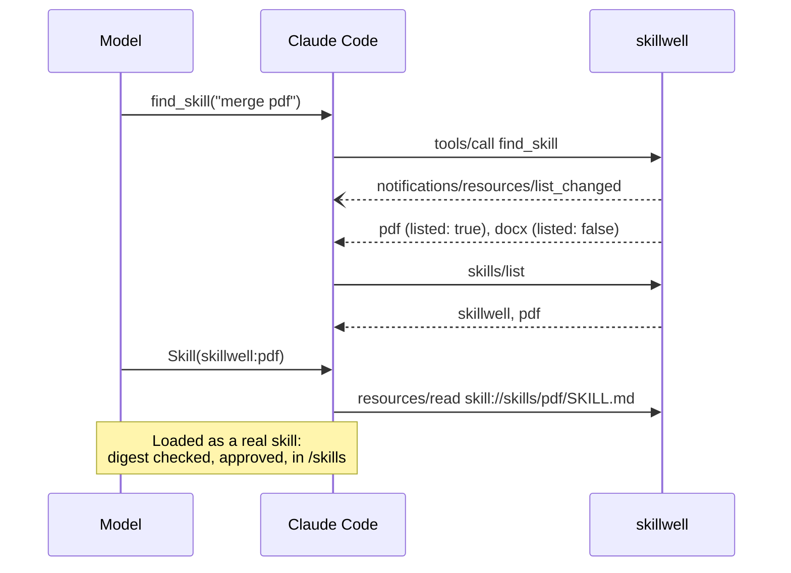

On November 24, Claude Code shipped support for skills over MCP as a public beta. An MCP server can now serve skills to Claude Code. They show up in `/skills` next to the ones in `~/.claude/skills`, load through the Skill tool, and ask for approval like any local skill.

That is a funny turn. For the past year, skills and CLIs have been the go-to answer to MCP. Why run a server and fill the context with tool definitions, when a skill can describe the job in a few lines of markdown and the agent can just call `gh`, `aws` or a script with its shell? Now skills are something an MCP server serves. The two meet, and each fixes something for the other: MCP gets a cheap way to hand an agent know-how, and skills get one way to reach every agent.

I have been wanting something like this for a while, for one use case.

# The use case: one library, little context

My skills are spread over `~/.claude/skills` for Claude Code, `~/.agents/skills` for other agents, a few from `npx skills`, and some folders I copied from git repos. That causes two problems:

- **Too many places.** Every agent has its own skills folder and its own update story. The same skill drifts between them, and I have no single view of what is installed or where it came from.
- **Too much context.** Every installed skill is listed in every session, with its name and description in front of the model, whether I use it or not. The more skills I collect, the more context every session pays before I type anything.

What I want is one library that every agent reads from, where the agent sees only a few skills up front and finds the rest when a task needs them. That is the use case this whole post keeps coming back to.

Skills over MCP looked like a way to get there: one server for every agent, instead of a folder per agent. The quickest way to find out was to build something on it. That became [skillwell](https://github.com/manojlds/skillwell), and building it is also how I learned what Claude Code really does with MCP skills, some of which surprised me.

This post covers what the skills extension is, what Claude Code does with it, and how skillwell uses it.

# What the skills extension is

> **Note:** Serving skills over MCP was sort of possible before this extension. Nothing stopped a server from exposing `SKILL.md` files as resources, and some did. The spec's own motivation points out that, without a convention, several implementations each made up their own `skill://` URI layout, and they disagree on what the authority, the path and nested files mean. The extension makes it one convention that hosts can treat as skills.

Skills over MCP is [SEP-2640](https://modelcontextprotocol.io/seps/2640-skills-extension), an MCP extension that went final on September 13. A server declares it under `io.modelcontextprotocol/skills`, and gets two new methods:

- **`skills/list`** returns the skills a server offers. Each entry has a `uri`, the skill's `frontmatter`, and its `resources`: every file in the skill with a `sha256` digest and a size.
- **`skills/get`** returns one skill by URI. It has to answer for every skill the server serves, listed or not.

This is the `pdf` skill from [anthropics/skills](https://github.com/anthropics/skills) as skillwell lists it, cut down to two of its files:

```json
{
  "skills": [
    {
      "uri": "skill://skills/pdf/SKILL.md",
      "frontmatter": {
        "name": "pdf",
        "description": "Use this skill whenever the user wants to do anything with PDF files. ..."
      },
      "resources": [
        { "uri": "skill://skills/pdf/SKILL.md", "digest": "sha256:d1c7caf5...", "size": 8058 },
        { "uri": "skill://skills/pdf/scripts/fill_fillable_fields.py", "digest": "sha256:d140872c...", "size": 3819 }
      ]
    }
  ]
}
```

The files themselves are plain MCP resources. A host reads `SKILL.md`, a script or a reference doc with the normal `resources/read`, under `skill://<skill-path>/<file>`.

The digests are the part I like most. The host's approval is tied to the whole set of files, so if a server changes, adds or removes any file in a skill, the approval no longer holds. For skills from other people's git repos, that is the property you want: you approved *this* version, not whatever the repo has next week.

The spec also says a listing may be partial, and a client must not read a short or empty listing as "this server has no skills". That one sentence is what makes skillwell possible.

# What Claude Code does with it

Claude Code's [MCP skills support](https://code.claude.com/docs/en/mcp) needs v2.1.331 or later, a direct Anthropic connection (no custom `ANTHROPIC_BASE_URL` or `apiKeyHelper`), and an interactive session: not `claude -p`, cloud sessions, the Agent SDK or GitHub Actions. A server's skills are named `<server>:<skill>`, so a `pdf` skill from a server called `docs` is `docs:pdf`.

Some frontmatter is ignored for MCP skills: `allowed-tools`, `hooks`, `model`, `context` and a few others. `!` commands don't run, `@` references aren't attached, and `${CLAUDE_PROJECT_DIR}` and `${CLAUDE_SESSION_ID}` are not filled in.

That sounds worse than it is. These are Claude Code extras on top of the open skills format, and portable skills don't use them. None of the 24 skills in my library has a `!` command or an `@` reference: the anthropics/skills ones point to their other files with plain markdown links, which the model follows with a resource read. One skill had `allowed-tools`, and losing it doesn't break anything, it just means a permission prompt for each command. Skills written for Claude Code alone fare worse: a `` !`git diff` `` arrives as literal text that the model has to choose to run itself.

The docs leave a lot unsaid, so I wrote a small spike server and logged every request Claude Code 2.1.332 sent to it. Five things stood out.

**1. The server has to speak the new protocol version.** Claude Code opens with `server/discover` from the 2026-07-28 protocol, and falls back to the 2025 `initialize` handshake if that fails. My first server used the SDK's `StdioServerTransport` with `connect()`, answered "method not found", and Claude Code fell back without complaint and never asked for skills. No error anywhere, just no skills. With the TypeScript SDK (`@modelcontextprotocol/server` 2.4.0), serving through `serveStdio()` fixed it.

**2. A listed skill costs the same context as a local one.** `/context` counts MCP skills in the same budget as local skills. Each listed skill puts its name and description in front of the model in every session. Serving a big library through `skills/list` saves nothing.

**3. An unlisted skill loads as a document, not a skill.** When the model found an unlisted skill through a search tool, Claude Code did not call `skills/get`. It read `SKILL.md` with the generic resource reader. The model followed it, but there was no Skill tool, no digest check, no approval and no `/skills` entry. Just a file the model read.

**4. Bundled scripts are not on disk.** A skill's scripts are resources, and Claude Code doesn't write them anywhere. `${CLAUDE_SKILL_DIR}` came through empty. The model read `scripts/hello.sh`, wrote its own copy into its scratchpad and ran that. It worked because the model was clever, not because anything was set up for it.

**5. Changes are caught when a skill loads.** I edited a skill's `SKILL.md` mid-session without telling Claude Code. The next load failed once with:

> The skill "beta" from MCP server "skillwell" was not loaded, because the server has changed it since it was listed. Its entry has been refreshed; invoke it again to load the current version.

The retry loaded the new version. No notifications needed, the digests do the work.

Put 2 and 3 together and you get the problem. **List everything, and you pay for every skill in every session. List nothing, and found skills arrive as plain text.**

# The prototype: list a router, promote what's found

For the use case, I need both: a small listing, and found skills that load as real skills. skillwell gets both. It lists one skill, a router, plus anything you pin. The router costs about 50 tokens and says:

```markdown
---
name: skillwell
description: Your skillwell library holds 23 more skills than are listed. Use this whenever no listed skill fits the task, before doing it from scratch.
---
```

Its body tells the model to call a `find_skill` tool. The trick is what happens next. When `find_skill` finds a match, skillwell adds it to the listing for the rest of the session and sends `notifications/resources/list_changed`. I couldn't find a skill-specific notification in the spec, but Claude Code calls `skills/list` again on this one. The model then loads the new skill through the Skill tool, with the digest check and approval intact.



**A found skill becomes a real skill mid-session, and costs context only from the moment it is found.**

In the spike, the whole round trip took under two seconds. The UI showed "1 skill available", then loaded the test skill, `skillwell:gamma`, like any local skill.

## Does the model actually search?

This was the question that could have sunk the whole idea. In my first tests the prompt said "look in the skillwell library", which proves nothing.

So I imported my real skills (4 of my own plus the 20 in anthropics/skills), pinned nothing, and gave Claude Code tasks that never mentioned skillwell:

- *"Write a short 3P update for my team"* → `find_skill` → `Skill(skillwell:internal-comms)`, then a read of the skill's example file. The update followed its format.
- *"What colours and fonts should I use so a slide looks on-brand for Anthropic?"* → `find_skill` → `Skill(skillwell:brand-guidelines)`, and the answer used its palette.

The router's description, plus a line in the server's MCP instructions telling the model to call `find_skill` before a task a skill might cover, was enough.

The same test found a problem. `find_skill` promoted every match, so two searches listed 10 skills, about 1.7k tokens, several of them unrelated. Now it lists only its top two matches, and only those scoring at least two-thirds as well as the best. The rest come back in the result, marked `"listed": false`, and still load through a `get_skill` tool. Rerunning the 3P prompt listed only the router and `internal-comms`.

That made search quality matter. The first version scored keyword hits, and "merge pdf files" listed `docx` next to `pdf`, because the docx description says "Do NOT use for PDFs". It now ranks with BM25 over the name, description and start of `SKILL.md`, with name matches weighted highest. It also drops "Do NOT use for..." sentences before indexing.

## What stays listed

Promotion is per session by default. A project can switch to `remember`, which writes found skills to `.skillwell/learned.yaml`, keeps the 20 most recently used, and lets the rest drop back to search-only. Commit that file and your team gets the same skills listed in that repo.

| Listed | When |
|---|---|
| Router | always |
| Pinned | always, in this project (`skillwell pin`) |
| Profiles | named sets, like `web` or `docs`, switched on per project |
| Learned | remembered from earlier sessions, most recent first |
| Found | this session's best `find_skill` matches |

Everything else is one search away.

## Running bundled scripts

skillwell is a local stdio server, so it knows where every skill lives on disk. It fills in `${CLAUDE_SKILL_DIR}` in a skill's markdown before serving it, and `find_skill` returns the folder too. A skill that says "run `${CLAUDE_SKILL_DIR}/scripts/fill_fillable_fields.py`" gets a real path, and the script runs from the library, not from a copy the model made.

## The library

The rest is what you would expect from something that holds other people's code:

- `skillwell add` takes a GitHub `owner/repo`, a folder in one, a single skill (`anthropics/skills@pdf`), a link pasted from the browser or from skills.sh, any git URL, or a local folder.
- Every pack is locked to a commit and a tree hash. `doctor` spots hand edits, `update` restores them.
- `skillwell import` pulls in what's already in `~/.claude/skills` and `~/.agents/skills`, and `--move` takes them out of there so agents stop listing them natively, with an `--undo`.

Because it is one MCP server, every agent that speaks MCP skills gets the same library. Agents that don't, like `claude -p` or the Agent SDK, can still use `find_skill` and `get_skill` as plain tools.

# Try it

skillwell is a prototype, but it is usable, and it is on npm:

```bash
npx skillwell init
npx skillwell add anthropics/skills
claude mcp add -s user skillwell -- npx -y skillwell serve
```

Start a new Claude Code session, check `/skills` for `skillwell:skillwell`, and ask for something a skill covers. To bring your existing skills along, `npx skillwell import --dry-run` shows what it would take.

# What's still rough

**It is a beta, and only in one place.** In Claude Code, MCP skills work only in interactive terminal, JetBrains and Desktop sessions, with VS Code rolling out. Outside Claude Code, VS Code Copilot reportedly has a beta and opencode an `mcp_skills` flag, which I haven't tried. Everything else gets the tools, not the skills.

**Some frontmatter is lost.** `allowed-tools`, `hooks` and `context: fork` are ignored for MCP skills. A skill that depends on them behaves differently when served over MCP.

**Scripts need a local server.** Filling in `${CLAUDE_SKILL_DIR}` works because skillwell and Claude Code share a disk. A remote, shared skillwell for a team would have to copy scripts down first, which is why there isn't one yet.

**Search is still lexical.** BM25 is good enough for 24 skills, and for the descriptions most skills have. It matches words, so a search for "invoice" won't find a skill that only talks about "billing documents". The router and instructions do some of the lifting, and the model usually searches with sensible keywords, but this is the first thing I would improve.

**Expect approval prompts.** Outside auto mode, Claude Code asks before it loads a found skill, and asks again whenever the skill's files change. That is the digests doing their job, but it means a round of prompts after every `skillwell update`.

# Where this goes next

I built skillwell to find out whether skills over MCP fits the use case: one library for every agent, without paying for every skill in every session. It does. The spec already had the right pieces: partial listings, per-file digests, and a host that relists when told. The prototype mostly uses them together, so a big library and a small context are not a trade-off anymore.

I'm going to live with it for a while, with every skill I have going through it, and see what breaks. If you try it, the repo is [manojlds/skillwell](https://github.com/manojlds/skillwell).
