import WebMCPTools from '@/components/WebMCPTools.astro';

Chris Tate [posted on November 3](https://x.com/ctatedev/status/2117419200528671059) that [wterm](https://wterm.dev), Vercel's terminal emulator for the web, now supports WebMCP. Agents on the page can list the terminals, read them, type and press keys. They don't scrape the DOM or fake keyboard events. The demo has five agents launching each other across four browser terminals.

I have been reading about WebMCP for a while without building anything with it. The wterm example was the first time a use case made sort of sense in a more exciting way, and it seemed like a good excuse to start.

So, this post is a WebMCP page. It registers tools about itself, and further down you can call them yourself, or watch an agent in your browser call them.

# What WebMCP is

WebMCP is a browser API that lets a page register tools for agents. A tool has a name, a description, a JSON Schema for its input, and a JavaScript function that runs when an agent calls it. The [spec](https://webmachinelearning.github.io/webmcp/) puts it this way:

> Web pages that use WebMCP can be thought of as Model Context Protocol servers that implement tools in client-side script instead of on the backend.

The point is what the agent does today without it. A browser agent looks at a screenshot or the accessibility tree, guesses which button is "Add to cart", clicks it, and takes another screenshot to see what happened. That works more often than it should. Unlike a scripted flow with CSS selectors, it doesn't break when the layout changes, because the agent looks again every time. The cost is elsewhere. Every step is a screenshot and a guess, so it is slow and expensive. And it goes wrong wherever the UI is ambiguous: an icon with no label, two buttons that both say "Add", a custom date picker, a result that only shows up in a toast that disappears.

With WebMCP the page says "here is `add_to_cart`, it takes a product id and a quantity", and the agent calls it.

The function runs in the page, in the user's logged-in session, through the same code the buttons use. The UI updates in front of the user as the agent works.

Registering a tool looks like this:

```js
await document.modelContext.registerTool({
  name: "read_section",
  description: "Return the plain text of one section of this post.",
  inputSchema: {
    type: "object",
    properties: { id: { type: "string" } },
    required: ["id"],
  },
  annotations: { readOnlyHint: true },
  async execute({ id }) {
    return { id, text: sectionText(id) };
  },
});
```

That is all a page needs. Annotations like `readOnlyHint` tell the agent which tools are safe to call without asking.

The spec is a draft and still changing. Even where the API lives has moved, from `navigator.modelContext` to `document.modelContext`, so I won't go further into it here. The [spec](https://webmachinelearning.github.io/webmcp/) has the current details.

# Try it on this post

These are the tools this post registers. Each one shows what an agent sees: a name, a description and an input schema. **Call** runs it the way an agent would and shows the response:

<WebMCPTools />

Try `highlight_section`. It scrolls the page to a heading and flashes it. That is the part a screenshot does not show: a tool call is not a request to some server, it is the page doing something in front of you. Pick `not-a-section` to see the error an agent gets back, with the list of valid ids in it.

When an agent calls one of these tools, its card shows the call too, so you can watch what the agent is doing.

If your browser has no WebMCP, the page uses a stand-in with the same API, so the buttons still work, but agents can't see the tools. ChatGPT Desktop supports WebMCP, and Chrome has it behind `chrome://flags/#enable-webmcp-testing`.

# When to use it

**Use it when the agent should work with the user in a page.** The tool calls the same functions as the buttons, in the session the user already has, so there is no second backend and no new auth. The agent stops guessing from screenshots, and the user watches the page change instead of reading "Done." in a transcript.

Some places where that fits:

- **Shopping and booking.** `search_flights`, `add_to_cart`, `checkout`, in the account the user is already signed in to, with the final click left to the user.
- **Shared canvases.** The [WebMCP Challenge](https://community.openai.com/t/the-webmcp-challenge-is-here/1392582) entries had video editors, beat machines and floor plans where a person and an agent edit the same thing. The UI is the shared state.
- **Terminals and consoles.** wterm's case: an agent runs `npm test` in a terminal you can watch and stop with Ctrl+C. A read-only terminal lets it watch logs without touching anything.
- **Runnable docs.** A tutorial, or a post like this one, where an agent can run each step and check the output.
- **Your own app while you build it.** Debug tools such as `seed_data` or `jump_to_state`, registered only in development, let a coding agent drive the app instead of clicking through it.

# How WebMCP differs from MCP

The names suggest WebMCP is MCP in a browser. It borrows MCP's idea of a tool, a name, a description and a JSON Schema, and almost nothing else.

```mermaid
flowchart TB
  subgraph MCPPath["MCP · a server the agent connects to"]
    A1["Agent<br/>Claude Code, ChatGPT, ..."] m1@--> C1["MCP client<br/>JSON-RPC over stdio or HTTP"]
    C1 m2@--> S1["MCP server<br/>Its own process, its own credentials"]
    S1 m3@--> B1["Backend APIs"]
  end
  subgraph WebPath["WebMCP · tools the page registers"]
    A2["Agent in the browser<br/>Built-in or extension"] w1@--> MC["document.modelContext<br/>A browser API, no protocol"]
    MC w2@--> P2["The page's JavaScript<br/>The user's session, the same code as the UI"]
    P2 w3@--> B2["The site's backend"]
  end
  m1@{ animate: true }
  m2@{ animate: true }
  m3@{ animate: true }
  w1@{ animate: true }
  w2@{ animate: true }
  w3@{ animate: true }

  classDef agent fill:#eaf3ff,stroke:#3978b5,color:#172b40;
  classDef bridge fill:#f1eef9,stroke:#8470ac,color:#302347;
  classDef page fill:#ebf7ef,stroke:#43845c,color:#173723;
  class A1,A2 agent;
  class C1,MC bridge;
  class S1,P2,B1,B2 page;
```



| | MCP | WebMCP |
|---|---|---|
| What it is | A protocol, JSON-RPC over stdio or HTTP | A browser API |
| Where tools run | A server process, local or remote | The page's JavaScript, in a tab |
| Auth | The server's own, OAuth for remote servers | Whatever session the user already has |
| When tools exist | Whenever the server runs | Only while the page is open |
| Who can call them | Any MCP client | Agents in that browser |
| What it offers | Tools, resources, prompts | Tools |
| The user sees | A tool call in the agent's UI | The page changing |

The last two rows are the ones that matter to me. An MCP server is a separate integration that someone has to build, host and secure, and the user watches it work through the agent's transcript. A WebMCP tool is a function on the page the user is already looking at. When the agent adds an item to the cart, the cart badge goes up.

**MCP gives an agent a service. WebMCP gives an agent the app the user is already using.**

They are not competing. A site that wants agents to work for its users with no browser in the picture, in Claude Code, a cron job or another server, needs an MCP server or an API. A site that wants agents to work with users in the page needs WebMCP. The same underlying functions can back both.

# What wterm gets right

wterm's [WebMCP support](https://github.com/vercel-labs/wterm/blob/main/apps/docs/content/docs/webmcp.mdx) is about 700 lines, and most of them deal with problems I would not have thought of before trying to build tools myself. They are a good checklist for any WebMCP tool.

**Errors go in the result, not in a throw.** Browsers drop the message of an error thrown from `execute`, so a tool that throws tells the agent nothing. wterm returns `{"error": "..."}` with enough detail to fix the call, like the list of valid terminal names. I copied that into this post's tools: `read_section` with a bad id lists the ids it knows.

**Waiting is part of reading.** Programs print asynchronously. `read_terminal` takes `waitFor` text, `waitForIdleMs` and a timeout, and returns what it has with `timedOut: true` instead of failing. Without that, an agent types `npm test` and reads an empty screen.

**One set of tools, addressed by name.** All terminals on a page share four tools that take a `terminal` name, instead of four tools per terminal. The name can be left out when there is only one terminal, or one has focus. That keeps the tool list short, which matters because every tool definition costs the agent context.

**Input calls go one at a time.** Typing a command waits 150 ms before pressing Enter, because agent CLIs detect pastes by how fast characters arrive. Two overlapping calls could land in that gap and merge into one command, so wterm runs a terminal's input calls in order.

**Tools exist only when they can work.** The input tools are registered only while at least one terminal accepts input, and a terminal can be marked `readOnly` for logs that agents should watch but not touch. Read results are marked `untrustedContentHint`, because anything a program prints can be written to mislead an agent.

# When not to use it

**When you need it to work today.** Few agents call it: ChatGPT Desktop does, Chrome and Edge have origin trials, and Gemini in Chrome is "soon". WebKit [opposes](https://github.com/WebKit/standards-positions/issues/670) it, so it may stay a Chromium and ChatGPT feature. Anything you build now is an experiment against a moving spec.

**When the tool can do damage.** Tools run with the user's privileges. A prompt injection on any page the agent reads can try to call tools where the user is logged in. If you do expose something destructive, keep a confirmation in the page and mark tools honestly.

**When there is no page.** No tab, no tools. Background agents, terminals and servers need an MCP server or an API.

# Where this goes next

This post is one example of what I want more of: pages that work with agents, not just pages agents can read. Whether WebMCP becomes the way to do that, or stays a Chromium experiment, I don't know yet. Giving the agent a function instead of a screenshot is the right idea either way.

If you have an agent with WebMCP, point it at this page and ask what the post says about MCP. Then watch the tool cards.

## References

- [WebMCP spec](https://webmachinelearning.github.io/webmcp/) and [repository](https://github.com/webmachinelearning/webmcp), including the [implementation status](https://github.com/webmachinelearning/webmcp/blob/main/implementation-status.md)
- [WebMCP in Chrome](https://developer.chrome.com/docs/ai/webmcp)
- [wterm WebMCP docs](https://github.com/vercel-labs/wterm/blob/main/apps/docs/content/docs/webmcp.mdx), added in [this commit](https://github.com/vercel-labs/wterm/commit/8dde5ea4b2b58c26eb6e2a2d37c49840a88574be)
- [agent-browser](https://github.com/vercel-labs/agent-browser)
