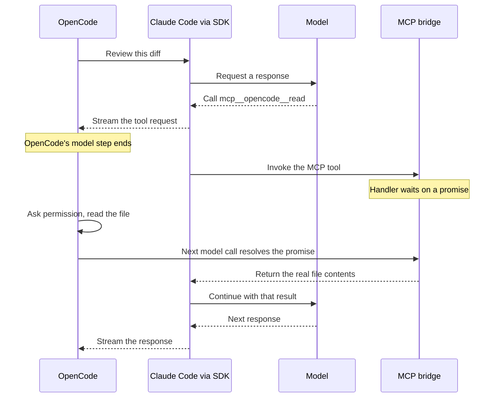
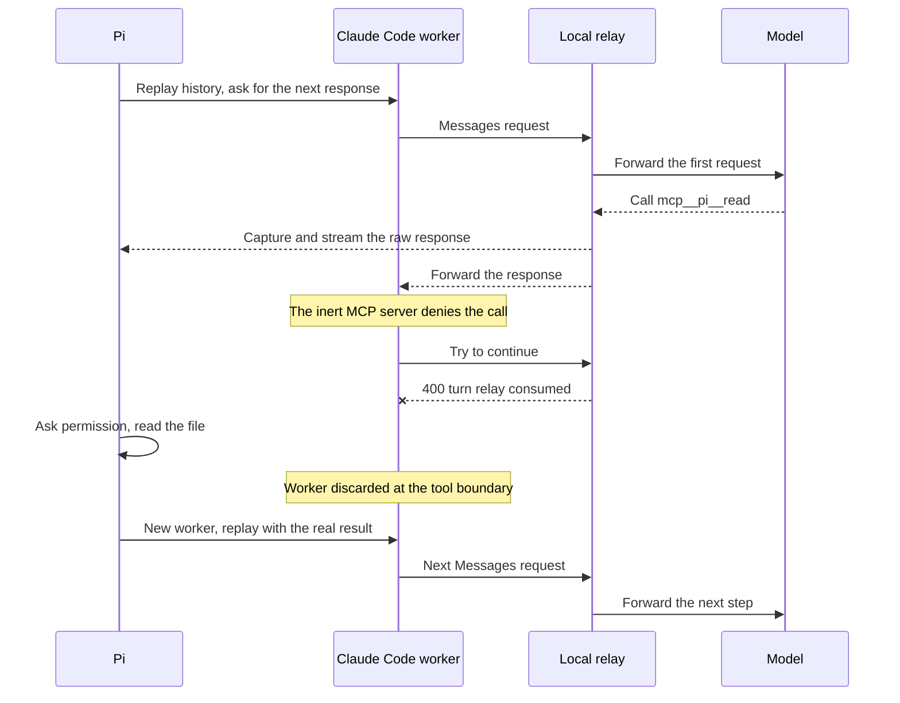
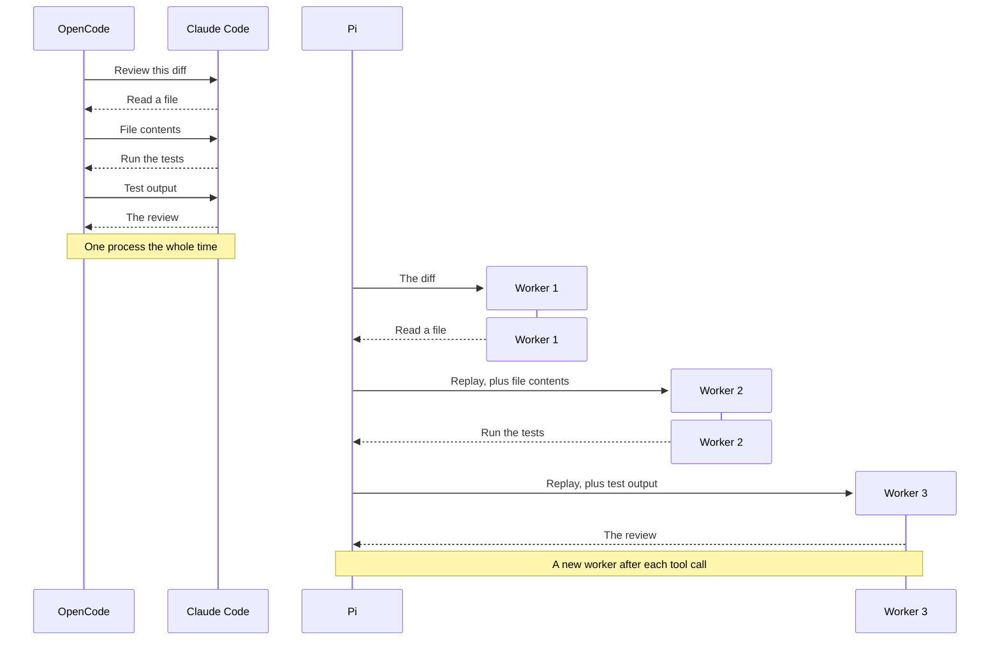

OpenCode just shipped a Claude Agent provider that runs on your existing Claude Code login. Pi has had something similar for a while through the pi-claude-code extension.

Both let you keep your Claude subscription and use a different coding agent on top of it. I wanted to know how, so I read the source of both.

The login turned out to be the easy part. The two integrations split on one question: what happens when the model asks to run a tool?

## What they have in common

Both run your installed `claude` program and let it handle the login. Neither copies your credentials.

Both turn off Claude Code's built-in tools and its compaction. OpenCode or Pi runs every tool and owns the approval prompts, so there is only one place a command can run.

Both describe their tools to Claude Code over MCP. That is where they part ways.

```mermaid
flowchart TB
  subgraph OpenCodePath["OpenCode · a native SDK session"]
    O["OpenCode<br/>Context, permissions, tools"] o1@--> S["Claude Agent SDK<br/>Public query API"]
    S o2@--> C["Installed Claude Code<br/>Existing login"]
    C o3@--> A["Anthropic API"]
  end
  subgraph PiPath["Pi · one model response per step"]
    P["Pi<br/>Context, permissions, tools"] p1@--> J["Installed Claude Code<br/>CLI stream-json protocol"]
    J p2@--> R["Local turn relay<br/>Gate, capture, rewrite"]
    R p3@--> B["Anthropic API"]
  end
  o1@{ animate: true }
  o2@{ animate: true }
  o3@{ animate: true }
  p1@{ animate: true }
  p2@{ animate: true }
  p3@{ animate: true }

  classDef host fill:#eaf3ff,stroke:#3978b5,color:#172b40;
  classDef bridge fill:#f1eef9,stroke:#8470ac,color:#302347;
  classDef upstream fill:#ebf7ef,stroke:#43845c,color:#173723;
  classDef relay fill:#fff3e6,stroke:#b77d38,color:#644015;
  class O,P host;
  class S,C,J bridge;
  class A,B upstream;
  class R relay;
```



## OpenCode: the tool call waits

OpenCode uses Anthropic's Claude Agent SDK, which is a wrapper around the Claude Code CLI. Claude Code talks to Anthropic directly. Nothing sits in between.

Say I ask it to review a diff and the model wants to read a file. Claude Code calls OpenCode's MCP tool. The handler for that tool does nothing except wait on a promise.

Meanwhile OpenCode sees the tool request in the SDK's stream. Its model step ends, its normal agent loop asks me for permission, reads the file, and makes its next model call. That call resolves the promise. The handler returns the real file contents, and Claude Code carries on in the same session.

Why bother with MCP if OpenCode can already see the request in the stream? Because the stream only goes one way. MCP is the only way to put a result back into Claude Code's running turn.

To OpenCode, Claude looks like any other model. Its design spec gives the reason: the history looks the same whichever model wrote it, and there is one permission system.



## Pi: the tool call is taken back

Pi drives `claude -p` directly and points it at a small HTTP relay on localhost instead of at Anthropic.

Pi also gives Claude Code an MCP server, but when Claude Code calls a tool, Pi's handler answers straight away:

```
Denied: Claude Code tools are inert; only Pi executes tools.
```

Pi only wants one model response from Claude Code. It runs the tool itself.

The catch is that Claude Code is an agent. After the denial it may try to recover by asking the model again, even with `--max-turns 1` and retries off. So the relay lets exactly one request through per step, keeps a copy of the raw response (tool arguments, signed thinking, usage), and answers anything after that with a 400.

Claude Code now has a denial in its history where Pi has a real result. So Pi throws that worker away and starts a fresh one for the next step, replaying Pi's own transcript into it.



## One request, two tool calls

Follow a review that reads a file, runs the tests, and writes the review. OpenCode uses one Claude Code process the whole way. Pi starts three workers, and the second and third each begin by replaying the conversation.



## Why the replay is hard

Claude Code adds its own context to every turn: reminders, environment details, skill lists. If that context moves around on every fresh worker, the prompt prefix changes and the prompt cache misses.

OpenCode avoids the problem by setting `verbatimPrompts`, which tells Claude Code not to add that context at all.

Pi lets Claude Code add it and fixes it up in the relay. It puts the reminders back in the same place on every replay and moves cache breakpoints so tool rounds don't break the cache. It's clever, but it depends on the exact shape of Claude Code's requests, and a Claude Code update could break it.

## System prompts

OpenCode keeps Claude Code's own system prompt and appends its agent's role and instructions. Pi replaces Claude Code's prompt with its own.

That matters most when your agent isn't a general coding agent. A review-only role in OpenCode sits on top of a prompt written for an agent that edits code. In Pi it sits inside a prompt you control. I haven't tested whether that changes behaviour.

The SDK supports custom prompts, and OpenCode already uses one for generating titles. Its spec doesn't say why chats keep the native prompt. On the PR, the maintainer said they have permission from Anthropic and it is fully ToS compliant. That comment doesn't say whether keeping the prompt was part of it.

## Billing

OpenCode accepts any login Claude Code has: subscription, API key, Bedrock or Vertex.

Pi is built for subscriptions and refuses to start if you have API key or backend overrides set. It also watches for overage. If a turn was billed to usage credits, it stops the agent loop. That turn is already charged, but the loop won't keep spending.

Pi's billing code also catches Anthropic's "third-party apps now draw from your extra usage" error. The extension expects Anthropic may tell its traffic apart from plain Claude Code.

## Side by side

| | OpenCode Claude Agent | Pi's `pi-claude-code` |
| --- | --- | --- |
| Talks to Claude Code through | Public Agent SDK | CLI `stream-json`, plus a local relay |
| Upstream requests | Sent by Claude Code, untouched | Gated, captured, and sometimes rewritten by the relay |
| Who runs tools | OpenCode, through an MCP handler that waits | Pi, after an inert MCP server denies the call |
| After a tool result | Same Claude Code session continues | New worker replays Pi's history |
| Process lifetime | One per chat, five minutes idle, resumable | One per model step after a tool call; at most two warm, five minutes each |
| Chat system prompt | Claude Code preset plus OpenCode additions | Pi's prompt replaces Claude Code's |
| History from other models | Catch-up content in a user message | Rebuilt from Pi's structured transcript |
| Edit or branch | Native fork at the last matching point | Rebuild from the selected history |
| Claude Code's per-turn context | Turned off with `verbatimPrompts` | Kept, and repositioned by the relay |
| Keeping the cache warm | Native continuity; branches keep the chat prompt | Reminder placement, cache breakpoints, tool-change replay |
| Logins accepted | Subscription, API key, cloud provider, custom gateway | Subscription only; conflicting overrides rejected |
| Main cost | Lives with Claude Code's prompt and history model | Owns replay and request-compatibility machinery |

## Which would I use?

For day-to-day coding I'd start with OpenCode. The session sees real tool results and nothing gets rebuilt after every tool call.

If I wanted the same system prompt and transcript across every model provider, Pi's approach fits better. The cost is owning the replay code as Claude Code changes.

Same model, same login. Different agent.

The full post has animated diagrams, the comparison table, and source links pinned to the exact commits:
https://stacktoheap.com/blog/2026/10/30/claude-subscriptions-two-harnesses/
